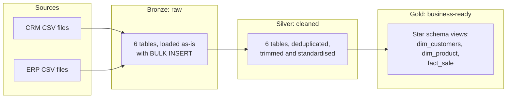
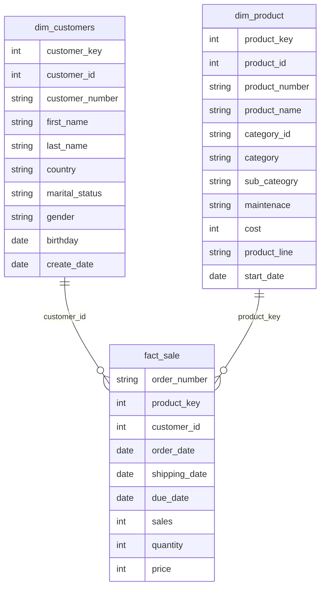

# SQL Data Warehouse

A data warehouse built on SQL Server using the medallion architecture (bronze, silver, gold). It takes raw CSV exports from two source systems, a CRM and an ERP, cleans and standardises them, and exposes a star schema for reporting on customers, products and sales.

## Architecture



| Layer | Schema | Object type | Load method | What happens |
|---|---|---|---|---|
| Bronze | `bronze` | Tables | Truncate and `BULK INSERT` | Source data copied unchanged |
| Silver | `silver` | Tables | Truncate and `INSERT ... SELECT` | Cleaning, deduplication, type fixes, code-to-label mapping |
| Gold | `gold` | Views | None (computed on read) | CRM and ERP data joined into dimensions and a fact |

## Source data

| File | Source | Rows (approx.) | Contents |
|---|---|---|---|
| `datasets/source_crm/cust_info.csv` | CRM | 18,500 | Customer names, marital status, gender |
| `datasets/source_crm/prd_info.csv` | CRM | 400 | Products, cost, product line, validity dates |
| `datasets/source_crm/sales_details.csv` | CRM | 60,400 | Order lines with dates, sales, quantity, price |
| `datasets/source_erp/CUST_AZ12.csv` | ERP | 18,500 | Customer birth date and gender |
| `datasets/source_erp/LOC_A101.csv` | ERP | 18,500 | Customer country |
| `datasets/source_erp/PX_CAT_G1V2.csv` | ERP | 36 | Product category, subcategory, maintenance flag |

## Repository layout

```
Database_init.sql      Creates the DataWareHouse database and the three schemas
DDL_BRONZE.sql         Creates the bronze tables
LOAD_BRONZE.sql        Creates the bronze.load_bronze stored procedure
DDL_SILVER.sql         Creates the silver tables
LOAD_SILVER.sql        Empty placeholder for a silver load procedure
silver/                One load script per silver table, plus a copy of the silver DDL
goldlayer.sql          Data checks and the three gold views
datasets/              Source CSV files
```

## Getting started

You need SQL Server (the free Express or Developer edition is enough) and SQL Server Management Studio or another T-SQL client.

1. **Create the database.** Run `Database_init.sql`. Run the `CREATE DATABASE` and `USE` statements first, then each `CREATE SCHEMA` on its own, because SQL Server requires `CREATE SCHEMA` to be the first statement in a batch.
2. **Create the bronze tables.** Run `DDL_BRONZE.sql`.
3. **Point the loader at your files.** `LOAD_BRONZE.sql` contains six hard-coded paths under `C:\Users\khatt\Desktop\SQLDATABASEWAREHOUSE\datasets\`. Replace them with the location of the `datasets` folder on your machine. The path must be readable by the SQL Server service, not only by your own user.
4. **Load bronze.** Run `LOAD_BRONZE.sql` to create the procedure, then:
   ```sql
   EXEC bronze.load_bronze;
   ```
5. **Create the silver tables.** Run `DDL_SILVER.sql`.
6. **Load silver.** Run each of the six scripts in `silver/` named after a table (`silver.crm_cust_info.sql` and so on). Order does not matter.
7. **Create the gold views.** `goldlayer.sql` mixes data checks with view definitions and has no `GO` separators, so run each `CREATE VIEW` statement on its own, `gold.dim_customers` and `gold.dim_product` before `gold.fact_sale`.

Every load truncates its target first, so all steps are safe to re-run.

## Silver transformations

| Table | Cleaning applied |
|---|---|
| `crm_cust_info` | Keeps the latest record per `cst_id`, trims names, maps `S`/`M` to Single/Married and `F`/`M` to Female/Male |
| `crm_prd_info` | Splits `prd_key` into `cat_id` and the product key, replaces missing cost with 0, expands product line codes, rebuilds `prd_end_dt` as the day before the next version starts |
| `crm_sales_details` | Converts integer `YYYYMMDD` dates to `DATE` (invalid values become `NULL`), recalculates sales when it disagrees with quantity × price, derives a missing or non-positive price |
| `erp_cust_az12` | Strips the `NAS` prefix from the customer ID, nulls birth dates in the future, normalises gender |
| `erp_loc_a101` | Removes hyphens from the customer ID, expands `DE`, `US` and `USA`, replaces blanks with `n/a` |
| `erp_px_cat_g1v2` | Copied unchanged |

Each silver table also has a `dwh_create_date` column recording when the row was loaded.

## Gold model



- **`gold.dim_customers`** combines CRM customers with ERP birth date and country. Gender comes from the CRM and falls back to the ERP when the CRM value is `n/a`.
- **`gold.dim_product`** joins products to their ERP category and keeps only the current version of each product (`prd_end_dt IS NULL`).
- **`gold.fact_sale`** holds one row per order line, linked to both dimensions.

Example query:

```sql
SELECT p.category, c.country, SUM(f.sales) AS total_sales
FROM gold.fact_sale f
LEFT JOIN gold.dim_product p   ON f.product_key = p.product_key
LEFT JOIN gold.dim_customers c ON f.customer_id = c.customer_id
GROUP BY p.category, c.country
ORDER BY total_sales DESC;
```

## Known limitations

- File paths in `LOAD_BRONZE.sql` are hard-coded to one machine.
- There is no silver load procedure yet; `LOAD_SILVER.sql` is empty and the six scripts are run by hand.
- `Database_init.sql` and `goldlayer.sql` cannot be run top to bottom in one go (see steps 1 and 7).
- `gold.fact_sale` links to customers by `customer_id` rather than the surrogate `customer_key`.
- Two columns in `gold.dim_product` are misspelled: `sub_cateogry` and `maintenace`.
